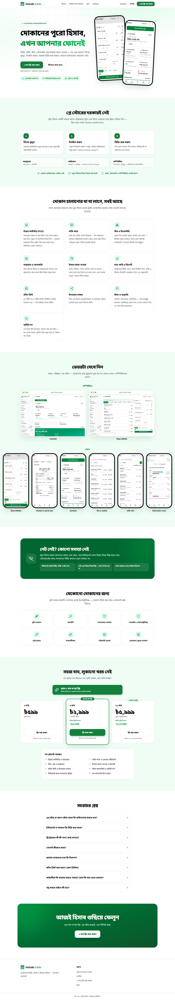

# Trade Hishab landing page

The one-page marketing site for **Trade Hishab / ট্রেড হিসাব**, served at **https://hishab.trade**.
The app itself lives at **https://app.hishab.trade** (a separate project: `store-app`).

- Bangla at `/` (the main search target) and English at `/en`, with `hreflang` links between them.
- Fully static: Next.js prerenders both pages to plain HTML at build time. No client components, no trackers.
- Strong SEO: titles and descriptions in both languages, canonical and `hreflang` tags, Open Graph and Twitter cards,
  JSON-LD (`Organization`, `WebSite`, `WebPage`, `SoftwareApplication` with the three plans, `FAQPage`),
  `sitemap.xml`, `robots.txt`.
- Light and dark follow the visitor's system setting, in CSS only.

| Mobile | Desktop |
| --- | --- |
|  |  |

## Run it

Node 22 and pnpm 10 (`corepack enable`).

```bash
pnpm install
pnpm dev          # http://localhost:3000
pnpm build && pnpm start
pnpm lint
pnpm typecheck
```

## Where things are

| What | Where |
| --- | --- |
| Prices, trial length, app and site URLs, contact details | `src/config/site.ts` |
| All the words, one file per language | `src/content/bn.ts`, `src/content/en.ts` (typed by `src/content/types.ts`) |
| Page sections | `src/components/landing/*` |
| Metadata and JSON-LD | `src/lib/seo.ts` |
| Brand colours and dark mode | `src/app/globals.css` |
| Logos | `public/brand/` (from the app's `public/brand/`) |
| App screenshots (mobile and desktop) | `public/shots/` |
| Share images, 1200 x 630 | `public/og/` |

Keep the prices in `src/config/site.ts` in step with the plans in the app (`store-app`: `src/billing/plans.ts`).
Current plans: ৳599 a month, ৳2,999 for 6 months, ৳5,999 for 12 months, with the first month free.

### Contact details (optional)

The footer shows WhatsApp and email only when these are set **at build time** (see `.env.example`):

```
SUPPORT_WHATSAPP=8801XXXXXXXXX
SUPPORT_EMAIL=support@hishab.trade
```

### Refreshing the screenshots

`public/shots/*.png` are real captures of the app's demo shop (`pnpm db:seed` in `store-app`), taken in Bangla at
390 x 844 (phone, 2x) and 1280 x 800 (computer, 1.5x). Retake them whenever the app's look changes.
`public/og/og-bn.png` and `og-en.png` are 1200 x 630 cards made the same way; they are static PNGs because the
`next/og` renderer does not shape Bangla conjuncts correctly.

## Deploy

Pick one. The page needs no environment variables and no database.

**Vercel or Cloudflare Pages.** Import this repo; the defaults work. Add `hishab.trade` as the domain.

**Docker (Dokploy / a VPS).** `.github/workflows/docker.yml` builds the image on every push to `main` and publishes
`ghcr.io/auxalo/store-app-landing:latest`. Point your host at that image (port 3000). Optional: set the
`SUPPORT_WHATSAPP` / `SUPPORT_EMAIL` repository variables for the footer, and a `DEPLOY_WEBHOOK_URL` secret to
trigger a redeploy.

### DNS

| Name | Points to |
| --- | --- |
| `hishab.trade` (apex) | this site |
| `www.hishab.trade` | redirect to `hishab.trade` |
| `app.hishab.trade` | the store app |

When the app moves to `app.hishab.trade`, set its `BETTER_AUTH_URL=https://app.hishab.trade`, and build it with
`NEXT_PUBLIC_SIGNUP_ENABLED=1` so the "Start 1 month free" button opens a working sign-up page.

## After launch

- Add `https://hishab.trade` as a property in Google Search Console and submit `https://hishab.trade/sitemap.xml`.
- Check the JSON-LD with Google's Rich Results Test and the share cards with a link preview.
- The first month free is set in the app (`trialDays` in `src/billing/plans.ts`, or the admin panel's settings).
